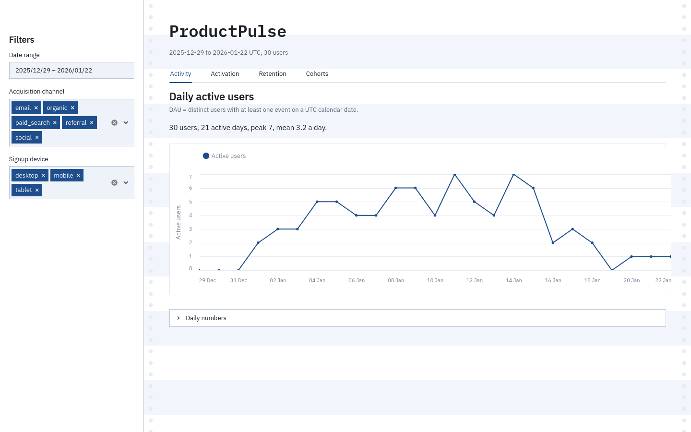

# ProductPulse

A local product analytics dashboard built with Streamlit and DuckDB. It covers
daily activity, activation, exact-calendar retention, and weekly cohorts.

## Run locally

```bash
make start
```

Open the Streamlit URL printed in the terminal, normally
<http://localhost:8501>.

To rebuild the local database without starting the dashboard:

```bash
make rebuild
```

## Dashboard

The sidebar filters the date range, acquisition channel, and signup device.
Each tab keeps its definition, chart, and table together.



- **Activity:** distinct users with an event on each UTC calendar date.
- **Activation:** eligible signups with an activation event from signup through
  day 7.
- **D1 and D7 retention:** users active on the exact UTC date one or seven days
  after signup.
- **Weekly cohorts:** users active in each Monday-aligned week after their
  signup week.

Pending activation and retention windows are shown as unavailable instead of
zero. Weekly cohort rates follow the same rule for unfinished weeks.

## Files

- `src/productpulse/dashboard.py` contains the Streamlit interface and filters.
- `src/productpulse/charts.py` contains the Altair charts.
- `sql/` contains the analytical queries.
- `data/productpulse.duckdb` is the local database used by the dashboard.
